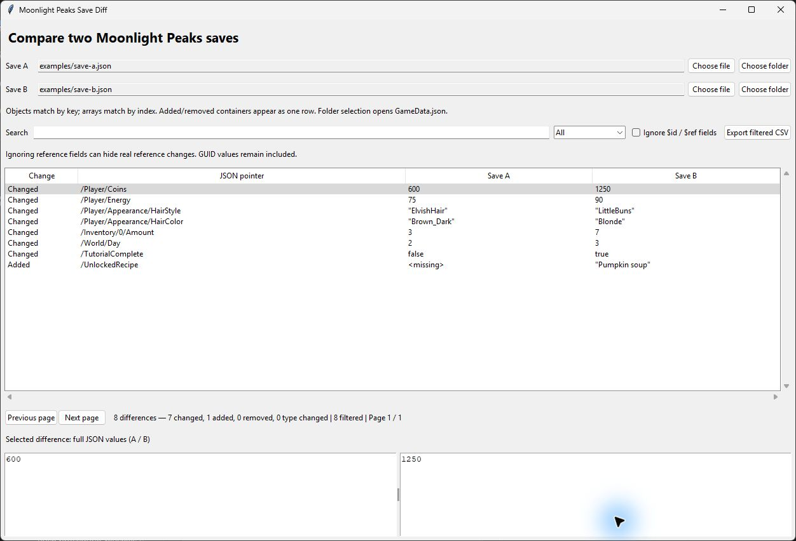

# Unity Save Editor & Diff

Double-click **Launch.cmd** to compare saves. Python 3.10+ with Tkinter is required. No third-party Python packages are needed.

1. Choose Save A and Save B using **Choose file**. Select GameData.json for gameplay or GameMetaData.json for menu summaries. Compressed backups and plain decoded JSON work too.
2. Alternatively, **Choose folder** opens that folder's GameData.json.
3. Differences appear automatically, with change type, JSON pointer, and values from both saves. Select a row to see the complete values below.
4. Search paths or values, filter by change type, and navigate pages of 1000 rows.
5. **Export filtered CSV** exports all matching rows across every page, retaining full JSON values and numeric precision.

Comparison is read-only. Neither source save is modified. The original editor remains available through **LaunchEditor.cmd**.



The screenshot uses the synthetic files in `examples/`, not personal game saves. Run `python save_diff.py --demo` to reproduce it.

## Run from source

```sh
git clone https://github.com/backwards-engineer/unity-save-editor.git
cd unity-save-editor
python save_diff.py
# Optional: open the original single-save editor
python save_editor.py
```

Windows users can use `Launch.cmd` for comparison or `LaunchEditor.cmd` for editing. On Linux, install your distribution's Tkinter package if needed. The application accepts standard gzip-compressed or plain UTF-8 JSON; other Unity serialization formats and encryption are not supported. Folder selection is tailored to Moonlight Peaks.

## How comparison works

Objects match by key and arrays by index. Whitespace, key ordering, equivalent string escapes, and equivalent numeric representations (1 versus 1.0) do not count as changes. Booleans and numbers are distinct. Added or removed containers appear as one row containing their complete JSON. Type changes appear as one row. `<missing>` is distinct from JSON null.

JSON pointers escape `/` as `~1` and `~` as `~0`. Array insertions or reordering can produce many changes because matching is positional. The tool does not resolve game object references or match entities across arrays by GUID.

**Ignore $id / $ref fields** is off by default. Enable it to reduce serializer reference noise; this can also conceal meaningful reference changes. It ignores those fields during traversal, while newly added/removed containers and type changes still show their complete raw JSON. Other GUID values remain included.

## Format and editor

The supplied saves are standard gzip (1f 8b 08), containing UTF-8 JSON with an EF BB BF byte-order mark. No additional encryption was found. GameData uses $id, $ref and $values for reference-preserving serialization. PNG files are ordinary images.

The original editor supports scalar edits and JSON import/export. Close the game before editing. Save + backup creates timestamped .editor-backup files, preserves the original BOM/compression, checks for external changes, and replaces the save atomically. Scalar edits preserve all text outside the changed token; $id and $ref are protected. JSON import allows structural changes. Metadata menu summaries are not automatically synchronized with gameplay data. To restore, close the game and copy an editor backup over its original filename.

## Verification

Run `python test_diff.py` from this directory for semantic comparison, JSON pointer escaping, structural differences, precision, reference filtering, CSV export and real-save comparisons. `python test_editor.py` tests the original editor. In-game loading of edited saves has not been tested.


## Privacy

The application works locally and has no network or telemetry features. Personal saves, raw extracted game assets, local dependencies, credentials, and machine-specific investigation scripts are excluded from this repository. The included examples are invented demonstration data. This repository contains no private key; use your own authentication when contributing.

## Repository history

The initial import uses generated, backdated commit timestamps spread over August–October 2026, at the owner's request. Those timestamps do not represent the actual development timeline.
